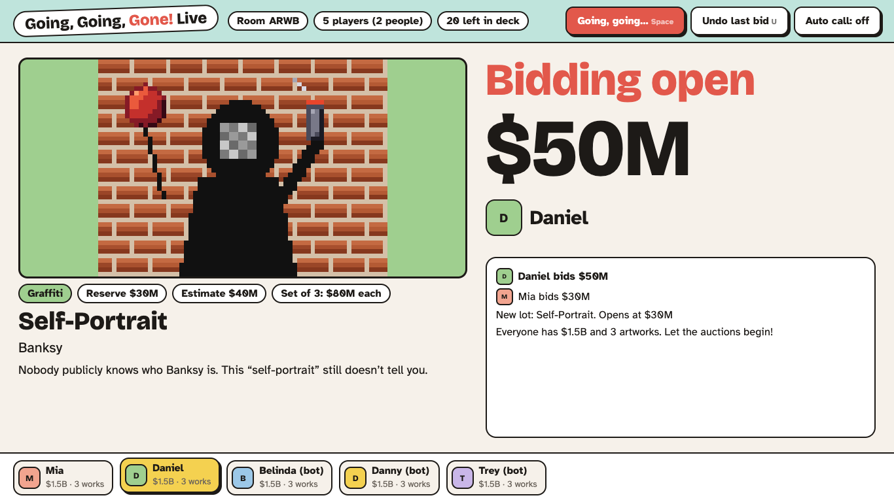
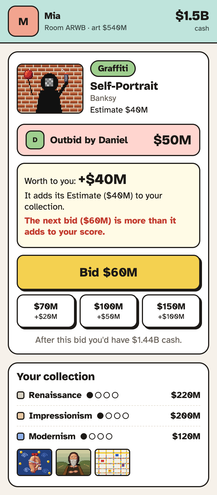
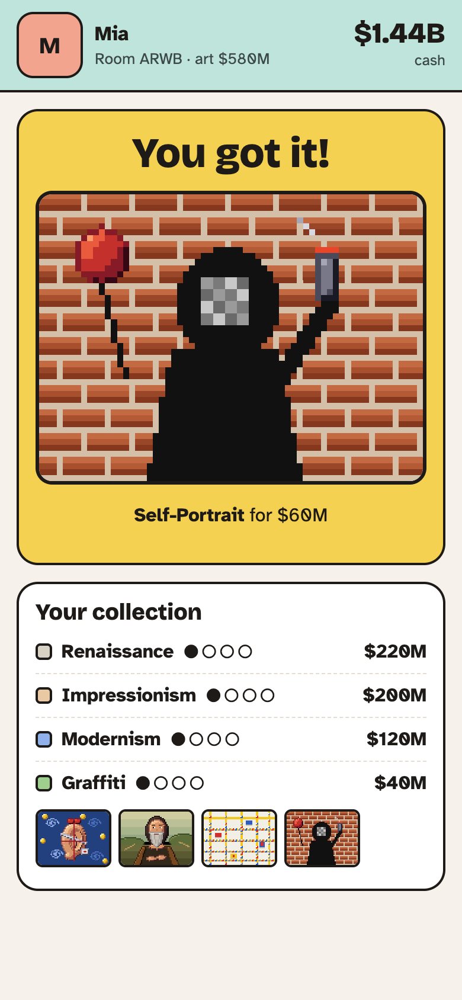
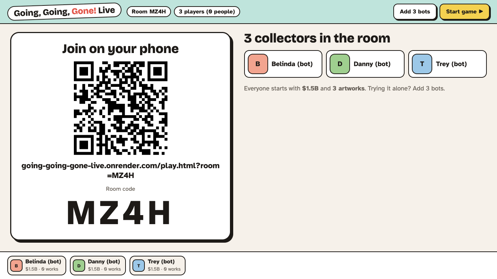
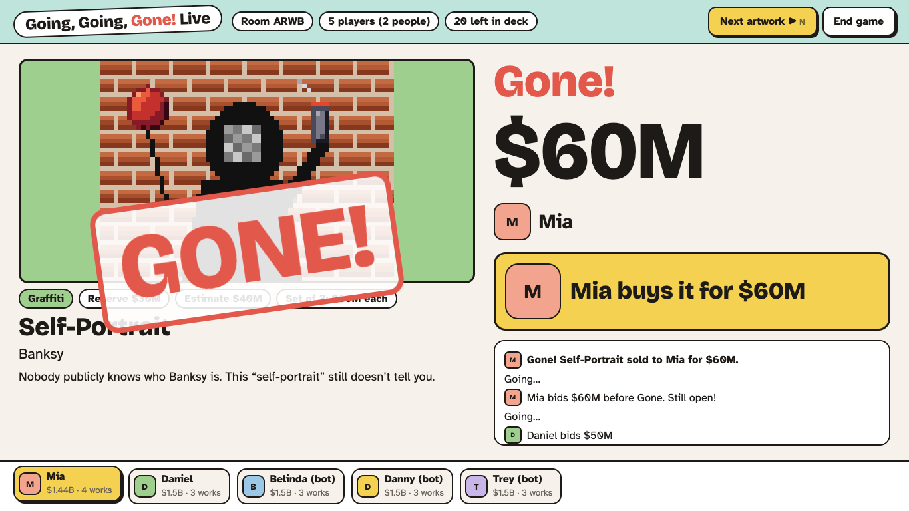
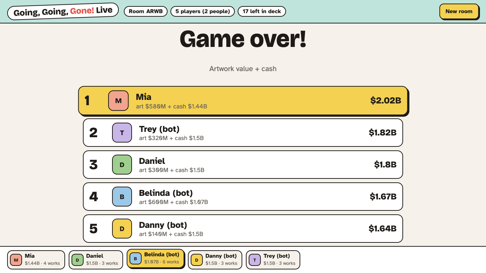

# Going, Going, Gone! Live

**English** · [中文](#中文)

**▶ Play now: [going-going-gone-live.onrender.com](https://going-going-gone-live.onrender.com)**
(projector: [`/host.html`](https://going-going-gone-live.onrender.com/host.html) · phones: scan the QR code)

A real-time classroom companion for the physical *Going, Going, Gone!* art-auction board game.
The teacher runs the auction on the projector; students bid from their phones. Before every bid,
each phone shows what the lot is **worth to that student** (set bonuses included), so the class
practises the decision the board game is about: *how much is this really worth to me?*



<p align="center">
  
  &nbsp;
  
</p>

## Features

**Projector (teacher)**
- Join screen with a QR code and a big 4-letter room code; players appear as they join.
- Each lot shows its pixel-art picture, story, Reserve and Estimate.
- The current bid, the leader and a live bid feed are shown in large type, readable from the back of the room.
- "Going… going…" countdown with a **GONE!** stamp. A bid during the countdown reopens the auction.
- Keyboard control: `N` next lot, `Space` call going, `U` undo a mis-tap. **Auto call** says "going" by itself after 4 quiet seconds.
- Final leaderboard (artwork value + cash).

**Phone (student)**
- **Worth to you**: how much this lot adds to *your* score, including "this makes 3 → all three double".
- A red warning when the next bid costs more than it adds, plus a list of rivals who are also collecting this movement.
- One big bid button and three quick raises showing the resulting price. Buttons turn grey when you can't afford them.
- Green when you lead. When you're outbid, the screen turns red and shakes, and the phone vibrates. A "You got it!" card when you win.
- Collection tracker (●●○○ per movement) with current value.
- Refreshing or losing signal keeps your seat (rejoins automatically).

**Solo / testing**: *Add 3 bots*. Computer collectors bid up to what a lot is worth to them, each with its own nerve.

| Lobby | Sold | Results |
| --- | --- | --- |
|  |  |  |

## Tech stack

| Layer | What | Why |
| --- | --- | --- |
| Server | **C# / ASP.NET Core 10** minimal API | One small process serves the pages, the API and the real-time hub |
| Real-time | **SignalR** (WebSockets, falls back to SSE / long polling) | Every bid is pushed to all screens in well under a second |
| Game logic | Plain C# state machine (`Lobby → Open → Going1 → Going2 → Sold → Ended`) | Server-authoritative: bids are validated (cash, min raise, no self-outbid) under a per-room lock |
| Countdown & bots | `Task.Delay` + `CancellationTokenSource`; a `BackgroundService` for bots | A new bid cancels the countdown, so nobody can win by lag |
| Front end | Vanilla HTML / CSS / JS (no framework, no build step) | Loads fast on school Wi-Fi and old phones |
| Art | Code-drawn pixel art (`pixart.js`, from [claude-pixel-art](https://github.com/andrew-wzj/claude-pixel-art)) | All 36 artworks without image files |
| QR | [qrcode-generator](https://github.com/kazuhikoarase/qrcode-generator) (MIT) | Points phones at the right URL: LAN address locally, public URL in the cloud |
| Tests | **xUnit** (15 tests) | Rules, bidding, undo, countdown revive, 2,000 concurrent bids |
| Hosting | **Docker** on **Render** (free plan, `render.yaml`) · `deploy-azure.sh` for Azure App Service | Push to `main` → auto-deploy |
| Safety | Rooms per IP capped, names cleaned, 4 KB message limit, rooms expire after 4 h | It is a public URL |

## How it works

```
 Projector (host.html) ──┐                         ┌─ RoomService ── Room (state, lock)
                         ├── SignalR /hub ── AuctionHub ─┤
 Phones (play.html)  ────┘   "state" snapshot ◄──────┘  └─ BotRunner (bots, auto call)
```

Every action (join, bid, host command) goes to the server. The server checks it, changes the room,
and broadcasts one full snapshot to everyone in the room. The clients only draw the snapshot, so all screens
always agree.

## Run it locally (same Wi-Fi, no internet needed)

```bash
cd src/GoingGoingGone.Live
dotnet run            # http://0.0.0.0:5080
```

Open `http://localhost:5080/host.html` on the projector computer; phones on the same Wi-Fi scan the QR code.
On macOS, allow incoming connections if the firewall asks. Run the tests with `dotnet test`.

## Deploy your own

[](https://render.com/deploy?repo=https://github.com/andrew-wzj/going-going-gone-live)

The free plan sleeps after 15 idle minutes: open the projector page a minute before class.
Rooms live in memory and reset when it sleeps or redeploys.

## Rules used

- Everyone starts with $1.5B and 3 random artworks.
- The first bid is the Reserve; each raise is at least $10M; you can't bid more cash than you have.
- Per art movement: 3 works double their Estimates, all 4 triple them.
- Score = artwork value + cash. An unsold lot goes to the bottom of the deck.

## Layout

```
src/GoingGoingGone.Live/
  Program.cs  hosting, static files, /hub, /api/info (join URL), /healthz
  Game/       Rules, Room (state machine), RoomService (countdown, broadcast, limits), BotRunner
  Hubs/       AuctionHub: the SignalR API used by both pages
  Data/       artworks.json (36 cards)
  wwwroot/    host.html (projector), play.html (phone), js/, css/, lib/
tests/        xUnit tests
Dockerfile · render.yaml · deploy-azure.sh
```

Third-party: `@microsoft/signalr` (MIT), `qrcode-generator` (MIT).

---

## 中文

**[English](#going-going-gone-live)** · 中文

**▶ 直接玩：[going-going-gone-live.onrender.com](https://going-going-gone-live.onrender.com)**

这是实体桌游 *Going, Going, Gone!*（艺术品拍卖）配套的课堂实时拍卖网页。老师在投影上主持拍卖，学生用手机出价。每次出价前，手机都会算出这件拍品**对你值多少**（包括凑齐 3 件翻倍、4 件三倍的加成），帮学生练习桌游的核心决策：这件东西对我到底值多少？

- **投影端**：二维码加房间码进入；显示拍品像素图、作品故事、起拍价和估价；大字号显示当前价和领先者；"Going… going…"倒计时，期间有人出新价就重新开放；结束时盖 GONE! 章；最后显示排行榜。快捷键：N 下一件，空格喊价，U 撤销误触。
- **手机端**："对你值多少"提示；出价超过价值时红字提醒；提示同样在收集这个流派的对手；大号出价按钮，钱不够时变灰；领先显示绿色，被超过时变红、抖动并震动；收藏进度 ●●○○；刷新或断网后自动回到自己的座位。
- **一个人测试**：可以加 3 个电脑玩家。

**技术栈**：C# / ASP.NET Core 10、SignalR 实时通信、服务器端状态机加每房间一把锁、Task.Delay + CancellationToken 做倒计时、BackgroundService 跑电脑玩家、原生 HTML/CSS/JS（无框架）、代码绘制的像素画、xUnit 15 个测试、Docker 部署到 Render（推送到 main 自动部署）。

**注意**：免费版 15 分钟没人用会休眠，上课前一分钟先打开投影页面。房间存在内存里，休眠后会清空。
